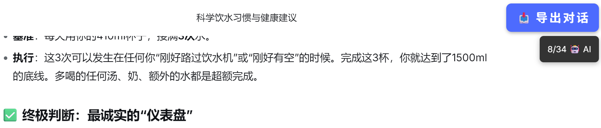
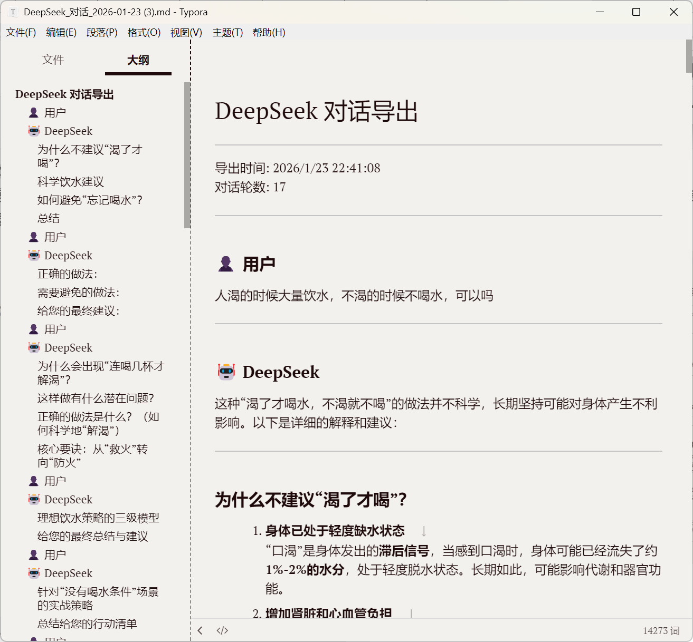

EN / [中文](./README.md)

# DeepSeek Raw Exporter

One-click export of DeepSeek conversation content to Markdown format, automatically distinguishing between user input and AI responses.

## Features

① **Accurate Recognition**: Automatically identifies copy buttons in dialog boxes, excluding interference from code blocks, images, and other content;

② **Role Differentiation**: Automatically distinguishes between user input (👤) and AI responses (🤖), with clear labeling during export;

③ **Real-time Progress**: Displays extraction progress and current message type being processed, with visual feedback;

④ **Format Standardization**: Exported Markdown files include timestamps, conversation round statistics, and clear separators.

## Usage Effect

### Extraction Process

*Real-time display of extraction progress, blue borders indicate user input, red borders indicate AI responses*

### Export Results

*Exported Markdown files automatically include role identifiers and timestamps*

## Greasyfork Download Link

[https://greasyfork.org/en/scripts/563762-deepseek-conversation-exporter](https://greasyfork.org/en/scripts/563762-deepseek-conversation-exporter)

## Notes

- Ensure the page is fully loaded before clicking the export button
- Do not refresh the page or switch conversations during the extraction process
- The script intercepts the copy interface to obtain original Markdown format data and does not actually write to the system clipboard

## Technical Principles

The script works in the following way:

1. **Button Recognition**: Analyzes button group structure - user input boxes have 2 buttons (copy, edit), while AI response boxes have 5 buttons (copy, regenerate, like, dislike, share)
2. **Data Interception**: Temporarily overrides the `navigator.clipboard.writeText` method to capture raw data written by the webpage
3. **Sequential Processing**: Clicks copy buttons in page order to ensure correct conversation sequence
4. **Formatted Output**: Organizes captured data into standardized Markdown format and downloads it

## Changelog

**v3.0** (2026-01-23)
- Added independent progress notification box that is no longer obscured by buttons
- Optimized button state management, disabling buttons during extraction to prevent duplicate clicks
- Improved recovery timing with intelligent display duration adjustment based on operation results

**v2.0** (2026-01-23)
- Precise identification of dialog box buttons, excluding copy buttons from code blocks and images
- Automatic distinction between user input and AI responses
- Optimized export format with role icons and statistical information

**v1.0** (2026-01-23)
- Basic export functionality implementation

## More Detailed Introduction
[【开源工具】DeepSeek-Raw-Export｜油猴脚本使用 DeepSeek 的复制按键直接导出-CSDN博客](https://shandianchengzi.blog.csdn.net/article/details/157300233)